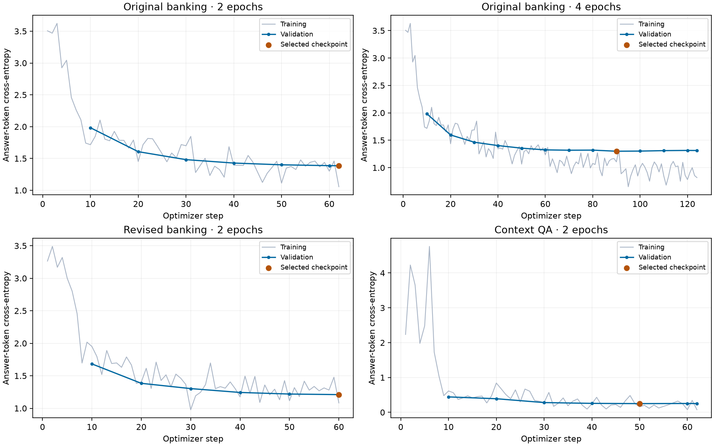

# APDS TP03 — Gemma 3 fine-tuning experiments

## Objective and workflow

This experiment adapts Gemma 3 4B instruction tuning to Khmer question answering. The workflow is: inspect and prepare data offline, freeze training/validation/test splits, evaluate the unchanged model, train an adapter, select a checkpoint using validation loss, and evaluate the same test prompts again. Test answers are used for evaluation only.

Gemma 3 is the pretrained model family. Parameter-efficient fine-tuning (PEFT) updates a small subset of parameters. LoRA implements this with trainable low-rank matrices while the original weights remain frozen. Here, the base model is loaded in 4-bit form and the language-model attention and MLP adapters are trained, following a QLoRA-style workflow. Vision layers are not trained.

## Data preparation

The supplied `dataasilida_cleaned.csv` contains 521 rows and is preserved unchanged. Inspection found multiple institutions, ambiguous product scope, duplicates/conflicts, and incomplete provenance; a clean-looking filename did not guarantee training-ready data. Cleaning and audit logic live in separate Python scripts so the notebook remains readable.

| Preparation | Retained | Review/quarantine | Train | Validation | Test |
| --- | ---: | ---: | ---: | ---: | ---: |
| Original banking preparation (`acleda`) | 303 | 218 | 241 | 30 | 32 |
| Revised banking preparation (`banking_v2`) | 276 | 245 | 234 | 20 | 22 |
| Alternative context QA (`khmerqa`) | 303 selected | Filtered from 2,501 source rows | 242 | 30 | 31 |

The revised banking policy adds an institution prefix when the source question or answer explicitly identifies one. It retains numeric service details with review flags rather than rejecting every numeric answer, and quarantines unresolved scope or conflicting records. Previously held-out groups remain excluded from training. Of the retained rows, 128 derive their institution label from the answer and still require scope review. Missing URLs and publication dates are not invented, and financial facts have not been independently verified.

The alternative dataset is a seeded, extractive subset of [sengtha/khmer-qa](https://huggingface.co/datasets/sengtha/khmer-qa/tree/3ca26dc817cae20dc4c574e7027b581ec7cb73ae). Its questions and answers were generated synthetically using Qwen2.5 from Khmer Wikipedia content. Selected answers occur in their supplied context; normalized context groups do not cross splits. Filtering checks Khmer text, empty/invalid records, duplicate groups, reserved chat tokens, and sequence length. This establishes structural eligibility, not human-verified factual correctness.

Banking is closed-book question answering; alternative QA supplies a passage with each question. Their absolute scores and validation losses therefore cannot establish which dataset or model is best overall. Compare the before/after change within each experiment.

## Configuration

| Setting | Value |
| --- | --- |
| Base model | `unsloth/gemma-3-4b-it-unsloth-bnb-4bit` |
| Training duration | 2 epochs; original banking also tested at 4 epochs |
| Learning rate | 0.0002 |
| Batch / gradient accumulation | 1 / 8 (effective batch 8 on one GPU, except partial final batch) |
| LoRA rank / alpha | 8 / 8 |
| Maximum sequence length | 2,048 tokens |
| Optimizer / schedule | 8-bit AdamW / linear decay, 5 warmup steps, weight decay 0.01 |
| Loss supervision | Assistant answer tokens, including end-of-turn; prompt/padding masked |
| Logging / evaluation / saving | Every 1 / 10 / 10 optimizer steps, with final evaluation |
| Checkpoint selection | Lowest validation loss |
| Seed | 3407 |
| Generation | Greedy, up to 768 new tokens within context budget; repetition penalty 1.1; no-repeat n-gram size 8 |
| Hardware | NVIDIA GeForce RTX 4060 Laptop GPU, 8 GB |

Epochs determine when training ends. Optimizer steps provide the monitoring axis. Changing the epoch budget also changes the linear learning-rate schedule, so the four-epoch run is a fresh experiment rather than a continuation of identical first-two-epoch updates. Each experiment starts from fresh base weights.

## Results

chrF measures character n-gram overlap with the reference on a 0–100 scale. It is useful for Khmer surface-form comparison but does not verify facts. Scores use the shared text-normalization function from `scripts/prepare_data.py`. Exact match is a secondary, strict reference-reproduction check: a correct paraphrase can fail it, and zero exact matches does not mean every answer is wholly wrong.

| Experiment | Test examples | Before chrF | After chrF | Change | Exact matches before → after |
| --- | ---: | ---: | ---: | ---: | ---: |
| Original banking · 2 epochs | 32 | 20.34 | 20.40 | +0.06 | 0 → 0 |
| Original banking · 4 epochs | 32 | 20.34 | 20.07 | -0.27 | 0 → 0 |
| Revised banking · 2 epochs | 22 | 22.97 | 20.78 | -2.19 | 0 → 0 |
| Context QA · 2 epochs | 31 | 20.50 | 32.14 | +11.64 | 0 → 8 |

| Experiment | Unexpected-script answers before → after | Generation-limit hits before → after |
| --- | ---: | ---: |
| Original banking · 2 epochs | 31 → 8 | 8 → 1 |
| Original banking · 4 epochs | 31 → 4 | 8 → 1 |
| Revised banking · 2 epochs | 22 → 3 | 2 → 1 |
| Context QA · 2 epochs | 19 → 1 | 0 → 0 |

The script check flags alphabetic characters outside Khmer and Latin. It cannot detect incorrect Khmer, foreign words written in Latin, factual errors, or missing answer content. A normal end-of-turn is not evidence that an answer is complete. Raw generated answers remain available for inspection rather than being cleaned into apparently better outputs.

## Loss analysis

| Experiment | Final step | Selected step | Lowest validation loss | Training minutes | Peak reserved GPU GB |
| --- | ---: | ---: | ---: | ---: | ---: |
| Original banking · 2 epochs | 62 | 62 | 1.3863 | 4.68 | 4.666 |
| Original banking · 4 epochs | 124 | 90 | 1.3002 | 7.66 | 4.670 |
| Revised banking · 2 epochs | 60 | 60 | 1.2103 | 5.76 | 4.732 |
| Context QA · 2 epochs | 62 | 50 | 0.2505 | 5.29 | 4.670 |

Training time above measures the trainer only; model loading and before/after generation add time. Memory is the framework's peak reserved GPU allocation, not total system memory.

For original banking, validation loss falls from approximately 1.98 at step 10 to 1.3863 at the end of two epochs. Four epochs reach a lower minimum of 1.3002 at step 90, then validation loss rises to 1.3134 at step 124. This is consistent with some overfitting after step 90; the evaluated adapter is the selected step-90 checkpoint. Despite its lower validation loss, its test chrF is lower than the two-epoch result. Lower teacher-forced loss does not guarantee better free-form answers.

The revised banking run reduces its validation loss from approximately 1.68 to 1.2103, but test chrF decreases. Its different prompts and test subset prevent a direct ranking against the original preparation. Reduced script mixing alone is insufficient evidence of factual improvement.

For alternative context QA, chrF increased from 20.50 to 32.14, with 8/31 exact matches after training. This result applies to this small, synthetic, context-supplied test set. It does not demonstrate that the model has learned reliable closed-book banking knowledge.

Its validation loss falls from 0.4430 at step 10 to 0.2505 at step 50, then rises slightly to 0.2526 at the final step 62. The selected step-50 checkpoint therefore precedes the end of training. The small late increase alone is limited evidence of overfitting, rather than proof that further training would always hurt.

## Answer quality and limitations

Banking predictions still invent product details and sometimes mix institutions. The fixed-deposit category reference names specific products that are absent from the original training split; memorizing other banking answers cannot supply those held-out facts reliably. Moving that test answer into training would invalidate the evaluation. Longer training did not resolve this coverage problem.

The alternative adapter learns a more concise answer style, but concise answers can still be wrong. For example, one test reference is `នាយសាន`, while the adapter returns `តយុទ្ធ`; another reference is `សហកម្មសិទ្ធិករទាំងអស់`, while the prediction is the incomplete `សហកម្មសិទ្ធិ`. It correctly reproduces `រឿងស្រមើស្រមៃ` in another example. Some synthetic references also contain awkward spans, such as `ចេនឡាគឺ`, where the model returns `ចេនឡា`. These cases require reading the question and passage, not simply trusting an overlap score. Structural cleaning has not established that all synthetic questions and target spans are semantically sound.

The experiments show that data scope, knowledge coverage, output style, and factual correctness are separate concerns. The revised preparation improves auditability but does not by itself establish better model accuracy. The next useful banking experiment would provide verified source passages at training and inference, or expand verified training coverage while preserving an untouched test set. Repeated inspection of these small test sets also makes them development evidence rather than an independent final benchmark.

## Reproduction and artifacts

Use the setup in [local setup guide](docs/SETUP.md). Select a preset in `APDS_TP03_Gemma3_Final.ipynb`, restart its kernel, and run all cells. Each run saves its settings, data/split hashes, environment versions, raw predictions, loss curve, checkpoint and adapter under `outputs/`. The report and archived results preserve the completed local experiments; the current local and Colab notebooks share the refactored training workflow.

Completed runs archived under `results/` (metrics, predictions, and loss plots):

- `acleda_2epochs-20261108T085958354107Z`
- `acleda_4epochs-20261108T092541199378Z`
- `banking_v2_2epochs-20261108T102848848703Z`
- `khmerqa_2epochs-20261108T104917074166Z`

The archived results retain their original run-time metadata and paths. The [summary CSV](docs/assets/experiment_summary.csv) preserves unrounded comparison values. Older 60-step runs used different generation settings and are excluded from this table. The original source and previous run folders remain unchanged.

Alternative data attribution: sengtha / iAny E-KHMER Technology and Wikipedia contributors; source revision `3ca26dc817cae20dc4c574e7027b581ec7cb73ae`. Dataset derivatives are distributed under [CC BY-SA 4.0](https://creativecommons.org/licenses/by-sa/4.0/). Preserve `data/sources/khmerqa/ATTRIBUTION.md`, upstream documentation and provenance when publishing the data. These dataset terms are not a statement about the model adapter's license.
